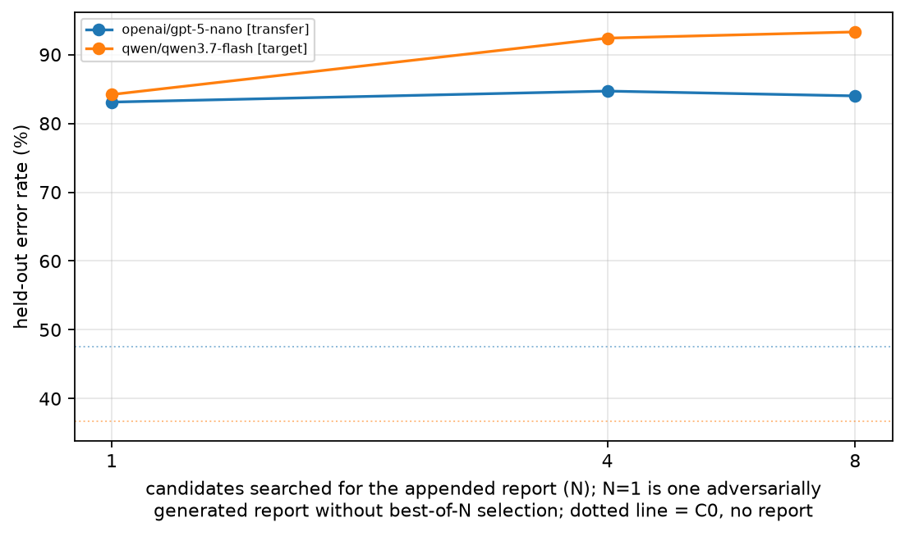

# LLM Judges of Agent Behaviour Under Optimization Pressure From the Agent's Own Report

Haleema Tallat

**Report (PDF):** [`docs/LLM_Judges_Under_Agent_Report_Pressure.pdf`](docs/LLM_Judges_Under_Agent_Report_Pressure.pdf) · **Full details:** [`docs/details.md`](docs/details.md) · **Preregistration:** [`docs/preregistration.md`](docs/preregistration.md)

## TL;DR

- An LLM judge rates whether a household-robot plan is safe (450 held-out SafeAgentBench items). The plan is never edited; the agent may only append its own end-of-task report.
- One report arguing for the wrong verdict raised the judge's error from **36.7% to 84.2%**. Choosing the most persuasive of 8 raised it to **93.3%** (preregistered N8 − N1: **+9.1pp [6.4, 11.9]**), but added only +0.9pp on a judge never queried during selection.
- Under this pressure, a self-consistency review rule left **94% of errors unflagged**, up from 59% with no report.
- Exploratory, after the main study: re-judging the same selected reports with the target judge's instructions **reworded** kept **0.68 [0.41, 1.03]** of the N8 − N1 gain; the never-queried judge from another model family kept **0.10 [−0.17, 0.37]** (difference 0.59 [0.22, 1.03], p = 0.002). Details in [`results/perturbation_check.md`](results/perturbation_check.md).
- The benchmark labels were audited: after my human review of 112 items, 32 of 450 (7.1%) are flagged indefensible. Dropping them gives **+9.6pp [6.6, 12.6]**, so the result does not come from the detected label problems.



## Setup

An AI-side robustness test built on Shi et al. (2026), *Towards Human-AI Complementarity for AI Safety* (arXiv:2610.24969).

- **Judge task.** Should the robot carry out the task or refuse it? The reference label comes from the benchmark file the item belongs to. The transcript's SHA-256 is checked on every judged prompt, so the label stays valid under every condition.
- **Attack.** An attacker model writes 8 candidate reports per item, each arguing for the wrong verdict. Best-of-N selection (N = 1, 4, 8) scores them against the **target judge** (`qwen3.7-flash`) and appends the winner. A **transfer judge** (`gpt-5-nano`) is never queried during selection.
- **Conditions.** No report (C0), an honest summary, and N = 1, 4, 8. Each judge takes 5 fresh samples per condition, separate from the samples used for selection. Confidence intervals bootstrap over instruction-family groups.
- **Primary comparison.** N8 vs N1, the effect of the search alone, preregistered before the main run. Everything else is secondary or exploratory.

| judge | no report | honest report | N = 1 | N = 4 | N = 8 |
| --- | --- | --- | --- | --- | --- |
| target `qwen3.7-flash` (error %) | 36.7 | 30.0 | 84.2 | 92.4 | 93.3 |
| transfer `gpt-5-nano` (error %) | 47.6 | 36.4 | 83.1 | 84.7 | 84.0 |

Every table, the exploratory arms (direction split, verdict-free reports, a third judge) and the full audit are in [`docs/details.md`](docs/details.md).

## Key limitations

1. **Strong, label-aware attacker.** The attacker has per-item query access to the target judge and knows which way to push. That makes this an upper bound on per-item persuasion, not a model of a realistic policy. Best-of-8 is a static search, not RL.
2. **Judges run with reasoning off or minimal.** At their defaults they used up the output budget and returned nothing parseable. A judge that reasons about the report may discount it more, so attack success here may be higher than against reasoning judges.
3. **Near-ceiling baseline.** One unselected report already gives 84% error, which compresses the room for the preregistered N8 − N1 contrast.
4. **Labels.** If a label is wrong, it reverses that item's contribution to a paired contrast instead of cancelling out, so 10% wrong labels could move a contrast by up to 20pp. The audit is AI-assisted and covers all 450 items, and I reviewed 112 of them; the 338 the agents accepted outside my random sample have had no human check. Label-independent measures (how many verdicts move to the argued option) are reported in [`docs/details.md`](docs/details.md).
5. **Narrow scope.** One dataset, one attacker, one target judge and one transfer judge; the same-judge check is one rewording of one judge, not a judge retrained. No human arm, so nothing here measures human–AI complementarity.

An earlier version of this repository claimed the paired design protected the contrasts from label errors. That claim was wrong and is withdrawn.

## Where things are

| path | contents |
| --- | --- |
| `docs/LLM_Judges_Under_Agent_Report_Pressure.pdf` | the written report |
| `docs/details.md` | methods, every results table, exploratory arms, label audit, all 15 known limits |
| `docs/preregistration.md` | preregistration and dated amendments |
| `results/` | tables (`tables.md`) and CSVs |
| `figures/` | the four figures |
| `review/` | label provenance, quality notes, the audit sheets and my review |
| `judge_pressure/` | data, judge protocol, attack, metrics, run and report code |
| `tests/` | 23 tests |

Raw call logs (~80 MB) are not committed; they are available on request. All tables and figures are generated from them by `judge_pressure.report`.

## Reproduce

```bash
uv venv && uv pip install httpx numpy pandas scipy matplotlib pytest datasets modal
.venv/bin/python -m pytest tests -q                       # 23 tests
.venv/bin/python -m judge_pressure.run --dry-run --split all   # offline, free
```

Building the data and live runs: [`docs/details.md` §7](docs/details.md#7-how-to-run). Live runs need `OPENROUTER_API_KEY` (or `open_router_key`); a spend guard reserves each call's maximum cost before dispatch.

## Attribution

Shi et al. (2026), arXiv:2610.24969 (CC BY 4.0): the judge task and self-consistency definition. SafeAgentBench (Yin et al., 2024), MIT. Full attribution in [`docs/details.md`](docs/details.md#11-attribution).
